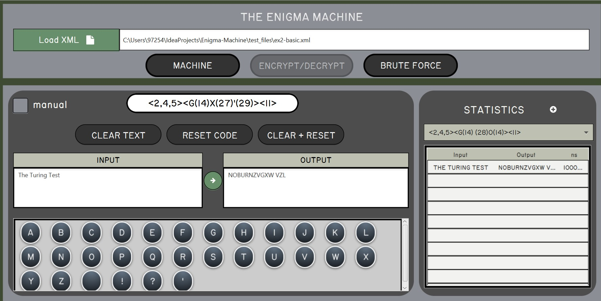
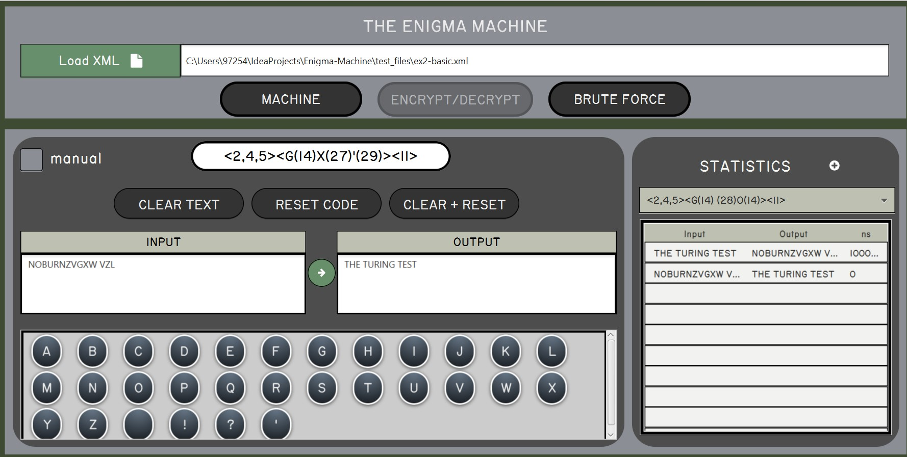

# Enigma Machine

A JavaFX desktop implementation of the WWII **Enigma** cipher machine, and a tool for breaking it.
You load a machine definition from XML, wire it up yourself (choose the rotors and their order, pick a
reflector, set the starting positions and the plugboard swaps), and encrypt or decrypt text through a
faithful simulation of the original rotor-stepping mechanics. On top of the simulator sits a
multi-threaded **brute-force cracker** that searches the configuration space against a dictionary to
recover plaintext without knowing the machine's settings.

## Getting Started

The quickest way to run the app is Docker, which compiles everything and streams the GUI to your browser
through noVNC, so you need no local Java, JavaFX, or X server. Build the image, run it, then open
<http://localhost:6080/vnc.html>. **Your first step in the app is to load a machine definition.** Use
the file chooser to pick one from `configuration_files/` (`ex2-basic.xml` is a good start), which is
baked into the image right where the chooser opens.

```bash
docker build -t enigma-gui .
docker run --rm -p 6080:6080 enigma-gui
# then open http://localhost:6080/vnc.html
```

> On Apple Silicon / non-amd64 hosts add `--platform=linux/amd64` to both commands. The build needs
> internet access (Maven Central + the JDK download).

## Technologies

- **Java 8** is the target runtime for every module in the project.
- **JavaFX 8** is the desktop UI toolkit, with screens laid out in **FXML** and styled by custom **CSS**
  plus two bundled TTF fonts.
- **FontAwesomeFX 8.9** supplies the icon glyphs used throughout the interface.
- **JAXB** reads machine definitions and dictionaries from XML and maps them onto Java objects.
- **`java.util.concurrent`** drives the brute-force engine (a thread pool of agents, a blocking task
  queue, and JavaFX `Task`/`Property` bindings) so the search never blocks the UI thread.
- **IntelliJ modules** structure the code; there is no build tool, so compilation is a plain `javac`.
- **Docker** (Xvfb + x11vnc + noVNC) provides the reproducible, browser-accessible run.

## Machine Features

### 1. Settings

The first page lets you assemble the machine: choose which rotors to include and in what order, set each
rotor's starting position, select a reflector, and define the plugboard swaps that pair characters
together (such as A = R). You can also let the program generate a random configuration for you.


### 2. Encryption / Decryption

Here you encrypt and decrypt text through the configured machine, character by character, with the
rotors stepping exactly as the original hardware did. Because Enigma is self-inverse, resetting the
machine to the same starting configuration and feeding the ciphertext back in returns the original
message. The history pane keeps a record of everything processed under each configuration.

           

### 3. Brute Force Decryption

The brute-force page attacks a ciphertext without knowing the settings: you pick words from the
dictionary as the target, choose a difficulty level that determines how much of the configuration space
is searched, and set the number of agents (the threads the machine will use), each working on a
different slice of permutations. Candidate decryptions stream into the UI live as they are found, and
the run can be paused, resumed, or stopped at any point.


## Project Structure

The code is organised as five IntelliJ modules: `GUI` is the main module and application entry point
(`app.Main`), `Machine` holds the cipher engine, the JAXB classes, and the brute-force manager, `DTO`
carries data across the UI/engine boundary, `CommoUtils` provides shared permutation and cloning
helpers, and `UI` is a standalone console front-end for the same engine. The machine definitions you
load into the app live in `configuration_files/` (older `ex1`-format samples and the XSD schemas are
kept in `test_files/`), and the container build lives in `Dockerfile` + `docker/`.

#
“Sometimes it is the people no one can imagine anything of who do the things no one can imagine.” - Alan Turing

